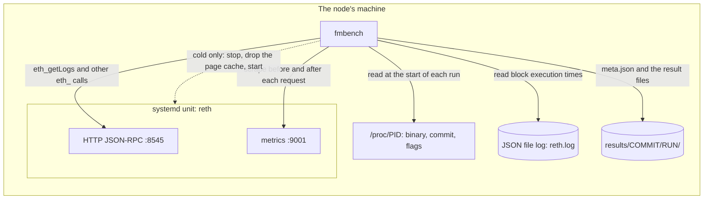
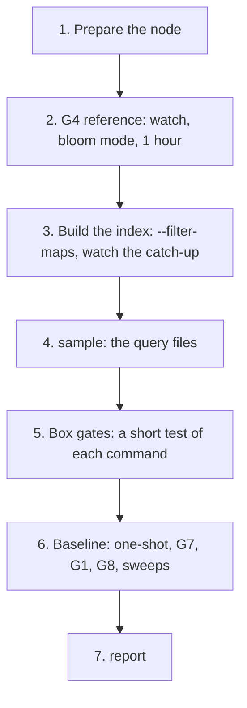

# fmbench

fmbench measures the FilterMaps local search index of a Reth fork. It compares two ways in which
the node serves `eth_getLogs`:

- **The index path.** The node finds the candidate blocks in its filter maps.
- **The header bloom path.** The node tests the header bloom of each block in the range. Reth
  uses this path today.

The kit sends the queries of heavy users: indexers, wallets, tax tools and explorers. It gives a
number and a verdict for each gate.

The kit is a command line tool for Python 3.10 or newer. It uses only the standard library. It
runs on the same machine as the node.

| | |
|---|---|
| Reth fork | [0xAysh/reth](https://github.com/0xAysh/reth), branch `feat/filter-maps-hardening` ([PR #10](https://github.com/0xAysh/reth/pull/10)) |
| Index design | [EIP-7745](https://eips.ethereum.org/EIPS/eip-7745). The fork uses it only as a local search index, with no consensus commitment |
| Pass rules | [`gates.json`](gates.json) |

## Terms

| Term | Meaning |
|---|---|
| Local search index | A database on the node that makes log queries faster. It does not prove that a result is correct or complete |
| Heavy user | A client that sends wide-range or high-volume `eth_getLogs` queries: protocol and factory indexers, wallets, tax tools, explorers |
| Header bloom | The 2,048-bit bloom filter in each block header |
| Candidate block | A block that can contain a matching log. The index can report extra candidates. It never misses a block with a match |
| Filter map | A grid of rows and columns that marks the addresses and topics of one run of consecutive logs |
| Finished map | A filter map whose slots are all assigned. The index stores only finished maps |
| Map group | 32 consecutive filter maps whose rows the index stores together: about 550 to 770 mainnet blocks |
| Epoch | A fixed run of filter maps that share one row assignment: about 20,000 mainnet blocks |
| Store target | The lower of the finalized block and the persisted block. The indexer renders blocks up to it |
| Index head | The last block that the stored finished maps cover completely |
| Tail cutoff | The block below which the index drops whole epochs: `--filter-maps.history` blocks (default 2,350,000) below the finalized block, or the lowest block with receipts if that is higher |
| Indexed window | The blocks that a query gets from the index: from the first indexed block to the index head. The header bloom serves all other blocks |

## The gates

| Gate | Question | Pass rule | Commands |
|---|---|---|---|
| **G1** correctness | Do the two paths return the same logs? | 0 differences in 10,000 queries or more | `run`, `equal` |
| **G4** node cost | Does the index make block execution slower? | Block time p50 and p99 at most 1.05 × the reference | `watch` |
| **G7** latency | Is one query faster on the index path? | A rule for each class type (see [Verdicts](#verdicts)) | `run` |
| **G8** throughput | Does the node serve more queries from many clients? | Index QPS at least the bloom QPS, and index p99 at most the bloom p99, at 1, 8, 32 and 64 clients | `load`, `watch` |
| **D2** one-shot | Can one request cover the whole indexed window? | The index request for the whole window takes at most the bloom p50 of the same Q1 filter at 100,000 blocks | `run` |

Each ratio has a noise band, the spread. A ratio in the band is `equal`, not a pass or a fail.

## How the kit works

The kit reads the node in four ways. It changes the node in one way only: a cold run restarts it.



This is one `run`. The other commands use the same parts:

```text
run --mode index --queries queries/g7.jsonl --cache warm --reps 25
  read the query file
  index mode: refuse a query outside the indexed window
  refuse a mode that does not agree with the node's flags
  write meta.json                    # binary, commit, flags, mode, cache, kernel, filesystem, CPU, RAM, query file hash
  for each repetition
    for each query                   # other queries run between two repetitions of one query
      cold only: restart the node    # see "Cold runs"
      scrape /metrics
      send eth_getLogs               # timed on the raw bytes
      scrape /metrics                # counter deltas for each path
      write one line to seq.jsonl    # latency, log count, log digest, counter deltas, error
  write the end time to meta.json
```

## What the kit contains

```text
.
├── gates.json        # the pass rule of each gate
├── fmbench/
│   ├── __main__.py   # python3 -m fmbench <command>
│   ├── sample.py     # sample: makes the query files
│   ├── run.py        # run: one query at a time (G1, G7, D2)
│   ├── equal.py      # equal: compares the logs of two runs (G1)
│   ├── load.py       # load: many clients at the same time (G8)
│   ├── sweep.py      # sweep: one filter over the window in chunks, as a backfill does
│   ├── watch.py      # watch: build rate, store size, index lag, block times (G3, G4)
│   ├── cold.py       # cold: restarts the node with an empty page cache
│   ├── report.py     # report: tables, chart CSVs and verdicts
│   ├── meta.py       # meta.json: what a result was measured on
│   ├── prom.py       # parser for the /metrics text format
│   ├── rpc.py        # JSON-RPC client with a timeout for each request
│   └── stats.py      # percentiles
└── tests/            # python3 -m unittest
```

| Command | Writes | For |
|---|---|---|
| `sample` | `queries/g7.jsonl`, `g1.jsonl`, `oneshot.jsonl` | The query files |
| `run` | `seq.jsonl` | G7 (`g7.jsonl`), G1 (`g1.jsonl`), D2 (`oneshot.jsonl`) |
| `equal A B` | Exit code 1 for a difference | G1 |
| `load` | `load.jsonl` | G8 |
| `sweep` | `sweep.jsonl` | The backfill time |
| `watch` | `watch.csv`, `blocks.csv` | Build rate, index lag (G3), G4 |
| `cold` | Nothing (`--dry-run` shows the steps) | A manual cold restart |
| `report DIR` | `report.md` and the chart CSVs | All gates |

Use `python3 -m fmbench <command> -h` to see the options of a command.

## The node

The kit compares three modes. Each mode is one node setup:

| Mode | Binary | `--filter-maps` |
|---|---|---|
| `index` | The fork | On |
| `bloom` | The same fork binary | Off |
| `today` | Reth 2.7.0 | Off (it has no index) |

The kit reads the node's command line. It refuses a run whose `--mode` does not agree with the node.

Give the node these flags in all modes:

```sh
--rpc.max-blocks-per-filter 0 --rpc.max-logs-per-response 0 --rpc.max-response-size 1024  # no RPC limit refuses a wide query
--metrics 127.0.0.1:9001                                                                  # the counters and gauges
--log.file.format json                                                                    # watch reads block times from the file log
```

Obey these conditions:

- Run the node as a systemd unit. The default unit name is `reth` (`--unit`).
- Run the kit as the node's user, on the node's machine.
- For a cold run, use root or a user with `sudo -n` (sudo with no password).
- The default URLs are `http://127.0.0.1:8545` (`--rpc`) and `http://127.0.0.1:9001/`
  (`--metrics`).

## How to benchmark

Do the steps in this order:



The examples use the paths of the bench machine: datadir `/data/reth`, log directory
`/data/logs`.

### 1. Prepare the node

1. Add the flags of [The node](#the-node) to the unit.
2. Restart the node.
3. Copy the kit to the node's machine.
4. Run the tests:

   ```sh
   python3 -m unittest
   ```

### 2. Measure the G4 reference

1. Start the node in bloom mode.
2. Wait until the node is at the chain head.
3. Watch the node for one hour. Do not send queries during this hour.

   ```sh
   python3 -m fmbench watch --mode bloom --phase off --log-file /data/logs/mainnet/reth.log --duration 3600
   ```

### 3. Build the index

1. Add `--filter-maps` to the node's flags.
2. Restart the node.
3. Start `watch` immediately. It records the build rate, the store size and the block times of
   the catch-up.

   ```sh
   python3 -m fmbench watch --mode index --phase catchup --log-file /data/logs/mainnet/reth.log
   ```

4. Stop `watch` with Ctrl-C when the index lag (`lag_maps` in `watch.csv`) stays at 1 map or
   less.

The default history is 2,350,000 blocks, about one year of mainnet.

### 4. Make the query files

Run `sample` against the node in index mode:

```sh
python3 -m fmbench sample
```

`sample` reads the indexed window from `/metrics`. It tallies the logs of 2,000 random blocks.
Then it selects the filters of each [query class](#query-classes).

The sampled window is smaller than the indexed window:

```text
first indexed block                                                    index head
|-- 100,000 (--tail-margin) --|========= sampled window =========|-- 2,000 --|
```

- **Tail margin.** The index drops whole epochs from its tail as the chain grows. Without a margin,
  the first blocks of the window leave the index within hours. Then `run` refuses the file.
- **Head margin.** After a restart, the index node renders its map group in progress again. It reads
  the receipts of those blocks, but a bloom-mode node does not. A cold query over those blocks
  would favour the index. Every query ends at the last block of the sampled window. The
  margin is sufficient while a filter map holds fewer than 62 blocks on average.

Make new query files for each new baseline.

### 5. Do the box gates

The box gates test each command once against the real node. Do them before the baseline.

```sh
# 2. index mode: 20 G7 queries
python3 -m fmbench run --mode index --queries queries/g7.jsonl --limit 20 --reps 1
# 3. G1: 100 queries in each mode (restart the node without --filter-maps between the two runs)
python3 -m fmbench run --mode index --queries queries/g1.jsonl --limit 100 --reps 1
python3 -m fmbench run --mode bloom --queries queries/g1.jsonl --limit 100 --reps 1
python3 -m fmbench equal results/<commit>/run-index-warm-g1-*/seq.jsonl results/<commit>/run-bloom-warm-g1-*/seq.jsonl
# 4. load: 8 clients for 30 s
python3 -m fmbench load --mode index --queries queries/g7.jsonl --clients 8 --duration 30
# 5. sweep: one Q1 filter in chunks of 100,000 blocks, in each mode
python3 -m fmbench sweep --mode index --queries queries/g7.jsonl --query Q1-w100000-000 --chunk 100000
# 6. watch: 10 minutes
python3 -m fmbench watch --mode index --phase catchup --log-file /data/logs/mainnet/reth.log --duration 600
# 7. report
python3 -m fmbench report results/<commit>/
```

The report of the box gates shows the G7 cells as `not measured`. This is correct: a run with
`--reps 1` has fewer than the 5 repetitions that a verdict needs.

### 6. Measure the baseline

Do these runs in each mode. Restart the node between two modes: change `--filter-maps` or the
binary. In mode `today`, do only the one-shot and the G7 runs.

1. Do the one-shot (D2) first:

   ```sh
   python3 -m fmbench run --mode index --queries queries/oneshot.jsonl --reps 1
   ```

2. Do the G7 matrix, warm and cold. Repeat each run once with `--spread`. The repeat must use the
   same query file, `--limit` and `--reps`.

   ```sh
   python3 -m fmbench run --mode index --queries queries/g7.jsonl --cache warm --reps 25
   python3 -m fmbench run --mode index --queries queries/g7.jsonl --cache warm --reps 25 --spread
   python3 -m fmbench run --mode index --queries queries/g7.jsonl --cache cold --reps 5
   python3 -m fmbench run --mode index --queries queries/g7.jsonl --cache cold --reps 5 --spread
   ```

   A cold run restarts the node before each repetition of each query. Calculate its time before
   you start it: queries × repetitions × the restart time of your node.

3. Do G1. G1 needs 10,000 queries or more, and `g1.jsonl` has 10,000:

   ```sh
   python3 -m fmbench run --mode index --queries queries/g1.jsonl --reps 1
   ```

4. Do G8. Start `watch` in a second terminal for G4 under load. Use the same `watch` in bloom
   mode: it is the reference of the index-mode load.

   ```sh
   python3 -m fmbench load --mode index --queries queries/g7.jsonl
   python3 -m fmbench watch --mode index --phase load --log-file /data/logs/mainnet/reth.log --duration 600
   ```

5. Do the sweeps, in chunks of 500, 2,000, 10,000 and 100,000 blocks:

   ```sh
   python3 -m fmbench sweep --mode index --queries queries/g7.jsonl --query Q1-w100000-000 --chunk 2000
   ```

   A sweep covers the sampled window, not the whole indexed window. Thus the two modes sweep the
   same blocks while the index tail moves.

### 7. Make the report

```sh
python3 -m fmbench report results/<fork commit>/ --today results/<2.7.0 commit>/
```

The today-mode runs go under the commit of the Reth 2.7.0 binary. `--today` adds them to the
today columns.

## Query classes

| Class | Filter | Widths (blocks) | Rule |
|---|---|---|---|
| Q1 | A rare address: 1 to 100 logs in the whole window | 500, 2,000, 10,000, 100,000 | selective |
| Q2 | A Q1 address with its `topic0` | 500 to 100,000 | selective |
| Q3 | A popular address: one of the 10 addresses with the most logs | 500 to 100,000 | dense |
| Q4 | The most popular `topic0` (on mainnet, `Transfer`) | 500 to 100,000 | dense |
| Q5 | A popular address with its most popular `topic0` | 500 to 100,000 | dense |
| Q6 | The Q1 filters near the end of the window | 1, 10, 100 | selective |
| Q6d | The Q3 filters near the end of the window | 1, 10, 100 | dense |
| Q7 | No address and no topic: all logs (the control) | 1, 10, 100 | equal |
| Q8 | One factory `topic0` (for example a pool's `Swap`) with 50, 200 or 1,000 addresses | 500 to 100,000 | selective |
| Q9 | Wallet transfers: `Transfer` to or from a rare address | 500 to 100,000 | selective |

`g7.jsonl` has 5 filters per class at each width. The kit drops a query whose estimated result
is more than 200,000 logs (`--max-logs`). Thus the dense classes stop at narrow widths. The header
of each query file lists the dropped queries (`dropped_by_cap`).

`g1.jsonl` has 10,000 random queries: a random class, filter, width and position in the window.
`oneshot.jsonl` has the first Q1 filter and the first Q9 filter over the whole indexed window.

## Verdicts

A verdict is `pass`, `fail`, `equal` or `not measured`. The kit compares each index-mode
percentile with the bloom-mode percentile of the same cell (class × width):

```text
ratio  = index pNN / bloom pNN
spread = larger / smaller - 1         # of the run and its --spread repeat, at least 0.05

judge(ratio, limit, spread)
  if limit / (1 + spread) <= ratio <= limit × (1 + spread)
    return equal                      # the noise cannot tell them apart
  return pass if ratio is on the better side of limit, else fail
```

| Type | Classes | Rule |
|---|---|---|
| selective | Q1, Q2, Q6, Q8, Q9 | p50 and p90 ratio at most 1.0. At 100,000 blocks or more, p50 ratio at most 0.5 |
| dense | Q3, Q4, Q5, Q6d | p50 ratio at most 1.10 |
| equal | Q7 | Pass when the p50 and p90 ratios are both `equal` to 1. Both paths use the header bloom for Q7 |

A cell fails if one ratio fails. It passes if all ratios pass. Otherwise it is `equal`. The
verdict of a gate is its worst cell.

A cell is `not measured` in these conditions:

- The run has fewer than 5 repetitions.
- The header bloom served part of an index-mode request: a failed index lookup, or a range below
  the index tail. Q7 is the exception, because Reth never looks it up in the index.
- A G8 client used more than 80 % of a CPU core, or a G8 request did not return `ok`.
- A run that the cell needs is missing.

`report` reads one `results/<commit>/` directory. It pairs the runs in this way:

- It uses the latest finished index-mode run of each kind.
- It compares that run only with bloom and today runs of the same query file, `--limit` and
  `--reps`. Thus a short test run never replaces the full matrix.
- It takes the spread only from a `--spread` repeat of the same queries.
- D2 uses the warm G7 bloom run only if that run comes from the same `sample` (same window and
  seed) and has 5 repetitions or more.

## Cold runs

`run --cache cold` and `cold` do these steps:

```text
cold restart
  index mode: read the index head
  systemctl stop reth
  sync
  echo 3 > /proc/sys/vm/drop_caches     # all steps through sudo -n if the user is not root
  systemctl start reth
  wait (at most 900 s) until
    the latest block is at most 24 s old
    the node has persisted blocks since the start
    index mode: the indexer has finished a step since the start
                no indexer step has failed              # else stop with an error
                the index head is back at its value before the stop
```

The kit waits for these conditions for these reasons:

- A restarted node executes the blocks of its downtime again. It writes them to disk in one
  batch. A query during that write competes with it. The indexer steps only after that write,
  so every mode waits for it.
- The first indexer step renders the map group in progress again. One step renders at most
  1,000 blocks. The head margin of `sample` keeps the queries out of those blocks.
- After the first step, the indexer renders only newly finalized blocks, as in a warm run. Thus
  `cold` does not wait for the finalized block to move.

## Results

```text
results/
└── <commit>/                                 # the node binary's commit, first 10 characters
    ├── run-index-warm-g7-<time>/
    │   ├── meta.json                         # what the result was measured on
    │   └── seq.jsonl                         # one line for each query and repetition
    ├── load-index-warm-load-<time>/load.jsonl
    ├── sweep-index-warm-<query>-c<chunk>-<time>/sweep.jsonl
    ├── watch-bloom-warm-off-<time>/          # watch.csv, blocks.csv
    ├── report.md                             # from report
    └── latency_vs_width.csv, work_vs_width.csv, throughput.csv, sweep.csv, build.csv
```

A result without its `meta.json` is not valid.
